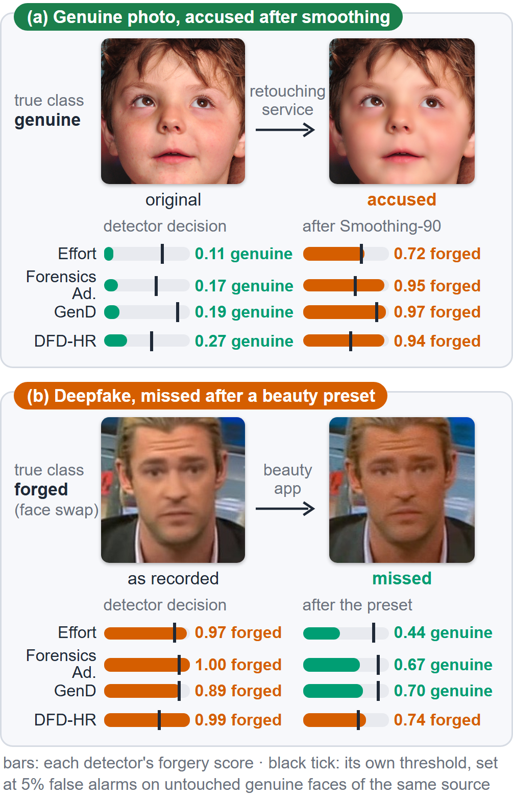
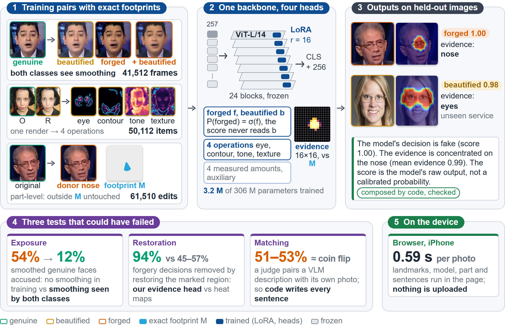

<div align="center">

# Beautified Is Not Forged
### A face checker that tells beautification from forgery, with evidence that can be checked

**Qin-Ying Lin, Bo-Rong Chen, Chen-Shan Yu**

[](docs/capstone/report_v3/report.pdf)
[](docs/paper_v2/main_v10j.pdf)
[](https://doreen1113.github.io/beautified-not-forged/docs/demo_ru/)
[](docs/capstone/video/capstone_video.mp4)
[](docs/capstone/poster/poster.pdf)
[](benchmark_release/)



*One edit, two errors. A genuine photo is accused after commercial skin smoothing; a face swap is missed after a beauty
preset. Four 2025 detectors, official weights, each at its own threshold.*

</div>

---

## TL;DR

Most face photos are beautified by a camera app or a retouching service before anyone checks them. A real / fake
detector has no answer for a beautified genuine face, so it has to put it on one side or the other, and either choice
is an error. We

- **measure the damage** on 17 published detectors with their released weights: 16 of 17 score a commercially smoothed
  genuine face as more forged than its own untouched original, and 13 of 17 call 36–69 % of them forged at a threshold
  set for 5 % false alarms on untouched faces;
- **find the cause** with a controlled training experiment (same model, data and recipe; only which class saw smoothing
  changes): smoothing shown to the forged class only raises the accusation to 64 %, shown to both classes it falls from
  54 % to 12 %;
- **build a three-way checker** (real / forged / beautified) on a frozen CLIP ViT-L/14 with LoRA (3.16 M trained
  parameters), trained on commercial retouching renders split into single operations with exact footprints and on
  part-level forgeries with exact footprints;
- **test the explanation instead of trusting it**: an evidence head marks the face part the decision came from; restoring
  that part to its original pixels removes **94 %** of the forgery decisions (ceiling 94.1 %, Grad-CAM 51 %). Free-form
  descriptions by vision-language models fail a blind matching test (51–53 %, chance 50 %), so every sentence shown is
  composed by code from the model's output and checked by rules before display;
- **ship it**: the whole chain runs in a web browser (MediaPipe → ONNX Runtime Web → outline, part name, sentences),
  **0.59 s** per photo on an iPhone, nothing uploaded.

## Results in short

| | ours | best published |
|---|---:|---:|
| FF++ test, three-way recall real / forged / beautified | 82.7 / 90.9 / 86.7 % | — (binary) |
| beautified frames called forged | 4.3 % | — |
| Alibaba, a retouching service never used in training: Smoothing-90 called beautified | 98.8 % | — |
| Alibaba renders called forged, any operation, any strength | ≤ 0.8 % | 6.3–68.7 % (smoothed, 5 % FPR) |
| Celeb-DF-B, AUC after app beautification, **trained on the same FF++ videos as the published detectors** | **0.872 / 0.870** (two seeds) | 0.838 (DFD-HR) |
| DFD + 16 unseen filters, AUC | **0.932** | 0.928 (DFD-HR) |
| Celeb-DF-v2 + 11 unseen filters, AUC | 0.873 / 0.875 (full data); 0.851 (FF++ only) | 0.856 (GenD) |

Paired bootstrap intervals on Celeb-DF-B exclude zero against Effort, Forensics Adapter and SBI. On untreated face swaps
the model is on par with the 2025 CLIP detectors, not above them; per filter it wins 4 of 11 on Celeb-DF-v2 and 7 of 16 on
DFD, and the three monochrome filters are its weakest. All numbers: `docs/capstone/report_v3/report.tex`
(every one is read from a result file under `results/research/`).

## Demo

**[Live page](https://doreen1113.github.io/beautified-not-forged/docs/demo_ru/)** · source in `docs/demo_ru/`. Choose or
take a face photo; the page answers real / fake / filter, outlines the evidence on the face and names the part, shows the
sentences that code composed and checked, and for a filter verdict the four operation scores. The browser model is an
EfficientNet-B4 with the same heads (17.6 M parameters, 67 MB); `cases.html` holds examples with known answers and the
accuracy on 50 faces per condition. To run it locally:

```bash
cd docs/demo_ru && python -m http.server 8000     # then open http://localhost:8000
```

**[Video (4 min 48 s)](docs/capstone/video/capstone_video.mp4)**: background, method, results, the browser demo, what comes
next (Chinese narration and subtitles, English on screen; built from `docs/capstone/video/`).

## Method



- **Three labels, defined by what an edit changes.** *real*: the capture as recorded. *beautified*: the same person at
  the same moment, only the appearance of their own face edited (smoothing, whitening, eye enlargement, slimming, colour
  filters), whatever tool did it. *forged*: a person or an action that was never captured (face swap, reenactment,
  synthesis, a transplanted part). A beautified forgery is still *forged*.
- **Both classes see beautification.** The exposure experiment is the reason: which class saw smoothing in training sets
  the sign of the error.
- **Render decomposition with exact footprints.** Commercial services apply several edits at once and do not say where.
  Dense optical flow splits the shape change into eye and contour; the residual is split by a low-pass filter into tone
  and texture. The four components rebuild the render at 108 dB, each with a pixel-exact footprint M: 18,734 Tencent and
  Megvii renders become 50,112 single-operation training items. Alibaba renders are never decomposed; they are test only.
- **Part-level forgeries with exact footprints** (61,510 edits): a facial part replaced, nothing outside M touched.
- **One backbone, four heads.** CLIP ViT-L/14 frozen (303.2 M), LoRA r = 16 on q, k, v, o of all 24 blocks; a
  classification head (forged f, beautified b; P(forged) = σ(f) never reads b), an operation head (eye, contour, tone,
  texture), an auxiliary quantity head, and an evidence head that scores each of the 256 patch tokens into a 16 × 16 map
  trained with BCE + Dice against M. The classifier never reads the map.
- **Sentences by code.** Templates filled from the model's record; a rule checker (decision word, named part, operation
  threshold, every number present in the record, no forbidden phrase, sentence count) runs before display. On the
  361-image holdout, 361 of 361 pass.

## What is not solved

- Reenactment is not covered (DF40 reenactment AUC 0.50 / 0.56).
- 20.8 % of untouched FFHQ originals are called beautified on the unseen service.
- Monochrome filters (inkwell, moon, grayscale) are the weakest group.
- Across services only skin smoothing is named reliably (AUROC 0.999; eye, contour, tone 0.69–0.72), and when several
  operations are stacked the model names smoothing alone.
- The main model is a single training run per seed (two seeds).

## Repository

```
docs/capstone/report_v3/       project report (LaTeX, PDF), figure scripts; every number read from a result file
docs/capstone/poster/          poster (90 x 120 cm) and its build script
docs/capstone/video/           the video: narration (edge-tts or a recorded voice), scenes as a function of time, renderer
docs/meeting_20261103/         final presentation deck (zh / en) with speaker notes
docs/paper_v2/                 paper draft and supplement (LaTeX), table and figure scripts
docs/demo_ru/                  browser demo (MediaPipe crop + ONNX Runtime Web), its tests and phone benchmarks
benchmark_release/             benchmark package v1.1.0: frame lists, adapters, scores of 17 detectors, scorer, leaderboard
results/research/
  retouch_unified_20260929/    main line: render decomposition, training, evaluation, explanation, PRE_DECLARED.md, FINDINGS.md
  cgd_20260927/                part-level forgeries, evidence head, restoration test
  celebdfb_v2_20260927/        Celeb-DF-B two-direction protocol
  ffpp_benchmark_20260925/     FF++ paired corpus, Celeb-DF-v2 / DFD frame lists, video-level AUC
  alipair_zeroshot_20260929/   unseen commercial service (Alibaba) before / after pairs
  op_naming_filters_20261105/  which operation the model names on unseen filters and on stacked operations
```

The earlier line of this project (hierarchical ShuffleNetV2 detector `pipeline.py`, data cleaning and filter scripts,
TFLite benchmarks) is preserved at the tag
[`v8-archive`](https://github.com/Doreen1113/beautified-not-forged/tree/v8-archive); its notes are in
[`docs/readme/LEGACY_README_v8.md`](docs/readme/LEGACY_README_v8.md).

Datasets and model weights are not in the repository. Data: FaceForensics++, Celeb-DF-v2, DFD, DF40, Celeb-DF-B (on
request from its authors), RetouchingFFHQ and FFHQ, each under its own licence.

## Citation

```bibtex
@misc{lin2026beautified,
  title  = {Beautified Is Not Forged: Separating Beautification from Face Forgery},
  author = {Lin, Qin-Ying and Chen, Bo-Rong and Yu, Chen-Shan},
  year   = {2026},
  note   = {Manuscript}
}
```

## Acknowledgements

Celeb-DF-B was provided by Libourel et al. (IWBF 2024). Baseline checkpoints come from DeepfakeBench and from the
official releases of SBI, Effort, Forensics Adapter, GenD and DFD-HR. Commercial retouching renders are from RetouchingFFHQ.
